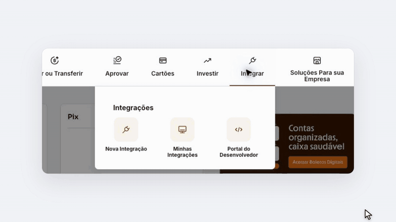
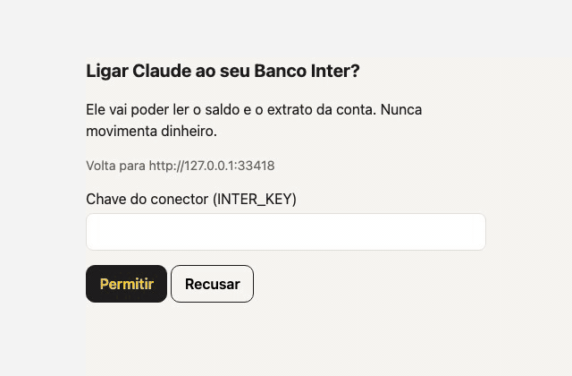

# Inter

O agente pode ler o saldo e o extrato da sua conta PJ no Banco Inter, pela API oficial. Qualquer outra chamada,
como um pagamento, é recusada antes de chegar ao banco.

## Antes de começar

- Uma conta Inter Empresas. A [API do Inter não atende contas PF nem MEI](https://ajuda.inter.co/conta-digital-pessoa-juridica/o-inter-disponibiliza-alguma-api-para-minha-conta-digital-pj).
- O celular da conta, para o código por SMS.

No fim, você terá `certificate/inter.crt`, `certificate/inter.key` e o client ID e o client secret da integração.

## No Inter

1. No [Internet Banking](https://contadigital.inter.co/), abra **Integrar** e clique em **Nova Integração**.
2. Em **Identificação**, dê um nome e uma descrição, como "Consulta de extrato e saldo", e clique em **Continuar**.
3. Em **Atividades**, marque só **Saldo e Extrato**, aceite os **Termos e condições** e clique em **Continuar**.
   Não abra **Configurações Avançadas**: ela descarta as marcações.
4. Informe o código que chega por SMS.
5. O Inter analisa o pedido e responde por e-mail, em até 30 dias úteis. Acompanhe em **Integrar > Minhas
   Integrações**.
6. Com a integração aprovada, baixe o certificado e a chave e copie o client ID e o client secret.
   <!-- TODO: gravar a tela da integração aprovada e o nome dos botões. -->



## No Três Pinos

O Inter entrega o certificado e a chave como `Inter API_Certificado.crt` e `Inter API_Chave.key`. Copie os dois
para a pasta `certificate/`, ao lado do `compose.yaml`:

```bash
mkdir -p certificate
cp "Inter API_Certificado.crt" certificate/inter.crt
cp "Inter API_Chave.key" certificate/inter.key
chmod 600 certificate/inter.key
docker run --rm -v ./certificate:/c alpine chown 1000:1000 /c/inter.crt /c/inter.key
```

No `.env`, inclua `inter` em `COMPOSE_PROFILES` e preencha as variáveis de [Configuração](#configuração). Depois:

```bash
docker compose up -d
```

## Ligar o agente

Na mesma máquina, ligue o agente em `http://127.0.0.1:3013/mcp`, com o cabeçalho
`Authorization: Bearer $INTER_KEY`.

Pela internet, publique a porta 3013 com HTTPS, por exemplo com um
[Cloudflare Tunnel](https://developers.cloudflare.com/cloudflare-one/networks/connectors/cloudflare-tunnel/), ponha o
endereço em `INTER_PUBLIC_URL` e adicione `<endereço>/mcp` como conector MCP no seu app de IA. O app abre uma página
do conector, onde você digita a `INTER_KEY`. Um app na nuvem precisa ter o endereço de retorno do login na lista de
[`oauth.mjs`](../../packages/server/src/oauth.mjs).

Depois, pergunte: "Qual é o saldo da minha conta no Inter?"



## Configuração

| Variável              | O que faz                                                    |
| --------------------- | ------------------------------------------------------------ |
| `INTER_KEY`           | Chave que o agente envia. Pelo menos 32 caracteres           |
| `INTER_CLIENT_ID`     | O client ID da integração                                    |
| `INTER_CLIENT_SECRET` | O client secret da integração                                |
| `INTER_CERT_DIR`      | Pasta com `inter.crt` e `inter.key`. Padrão: `./certificate` |
| `INTER_PUBLIC_URL`    | Endereço público com HTTPS, para entrar com login. Opcional  |

## Ferramentas

| Ferramenta      | O que devolve                                                                         |
| --------------- | ------------------------------------------------------------------------------------- |
| `get_balance`   | Saldo e limite, em centavos. Um limite que o Inter não informa vem como `null`        |
| `get_statement` | As transações de um mês, em centavos. Um mês com mais de 10.000 transações é recusado |

O Inter aceita só uns cinco tokens por minuto; o conector usa o mesmo token por quase uma hora, então isso não
limita as ferramentas.
